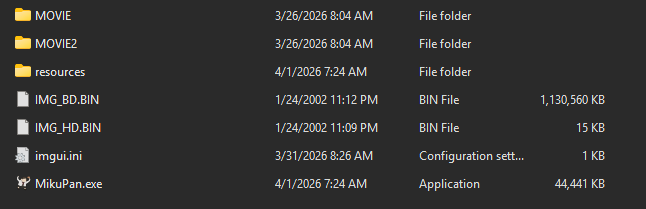

# What is MikuPan?
MikuPan is an in progress port of Fatal Frame 1 PS2 to PC running natively, no emulation. Still very early work.


[](https://discord.gg/Ap4Sfcmwd9)


# Build
For now, building in `debug` is highly recommended due to issues related to the `release` build. The build process was made to automatically fetch all required dependencies of the project.

## CMake presets
Use the CMake presets to switch between the NTSC-U and PAL/EU builds without
editing cache variables manually. The default presets target NTSC-U game data;
the `*-eu` presets set `BUILD_EU_VERSION=ON` and target PAL/EU game data.

```powershell
cmake --preset debug
cmake --build --preset debug

cmake --preset debug-eu
cmake --build --preset debug-eu
```

Available native presets are `debug`, `debug-eu`, `release`, `release-eu`,
`relwithdebinfo`, and `relwithdebinfo-eu`.

## Assets
You need to copy the files `IMG_HD.BIN` and `IMG_BD.BIN` from the matching Fatal Frame ISO to the folder containing the `MikuPan` executable.

Use the NTSC-U (USA) ISO with the default presets, or the PAL (EU) ISO with an `*-eu` preset. NTSC-J (Japan) ISOs will *NOT* work.
The executable will be located at `{CMake-Build-Directory}/MikuPan`.




On first launch MikuPan converts the model and 2D textures of these files once
(a few seconds) into `IMG_TEX.BIN` next to its configuration; the game data
itself is not modified. Delete `IMG_TEX.BIN` to convert again.

Optionally, run [sgdstitch](tools/sgdstitch/README.md) on the two files to merge
the small PS2-sized mesh batches of the 3D models: characters need about half
the draw calls while drawing the same triangles.

## Windows
You need either `MinGW` or `Cygwin` with `gcc` and `CMake` in order to build `MikuPan`. `MSVC` with *CMake* will *ALSO* work. 

## Linux
`GCC`, `CMake`, `Make` and `Git` are required to build `MikuPan`.
FFmpeg is built automatically with only MPEG-1/2 video decoding, MPEG program
stream demuxing, MPEG elementary-stream probing, local file access and colour conversion. Movie audio uses
MikuPan's own decoder; FFmpeg audio codecs and resampling are disabled.

```sh
cmake -S . -B build -DCMAKE_BUILD_TYPE=Release
cmake --build build -j
```

To reuse shader bytecode already generated or downloaded, configure with
`-DMIKUPAN_COMPILE_SHADERS=OFF`.

## macOS
macOS is not officially supported: the maintainers have no Apple hardware to
actively test on, so it may break between releases. It has been verified to
build and run on Apple Silicon by contributors. Building needs the Xcode Command Line Tools
(`xcode-select --install`) plus `cmake`, `ninja` and `git` from Homebrew:

```sh
brew install cmake ninja git
cmake -B build -G Ninja -DCMAKE_BUILD_TYPE=Debug
cmake --build build
```

SDL3, FFmpeg and SDL_shadercross are fetched and compiled from source during the
build; the first configure/build is slow because shadercross includes
DirectXShaderCompiler. The renderer uses the Metal backend of SDL_GPU, so no
Vulkan/MoltenVK install is needed. The result is a bare `build/MikuPan/MikuPan`
executable rather than a `.app` bundle.

## Android
Android builds use the NDK CMake toolchain and produce a debug-signed APK with
the `MikuPan-apk` target. Requirements: Android SDK 35 or newer, Android NDK
r28c or newer, Java JDK, Ninja, and a `zip` executable.

Android FFmpeg is consumed as prebuilt shared libraries. The preferred layout is
a merged `libffmpeg.so` for each ABI:

```text
extern/ffmpeg/android/arm64-v8a/include
extern/ffmpeg/android/arm64-v8a/lib/libffmpeg.so
```

The library may also live directly in the ABI folder:

```text
extern/ffmpeg/android/arm64-v8a/include
extern/ffmpeg/android/arm64-v8a/libffmpeg.so
```

The legacy local folder name is also supported:

```text
extern/ffmpeg/include
extern/ffmpeg-android/arm64-v8a/libffmpeg.so
```

Split FFmpeg libraries are also supported:

```text
extern/ffmpeg/android/arm64-v8a/include
extern/ffmpeg/android/arm64-v8a/lib/libavcodec.so
extern/ffmpeg/android/arm64-v8a/lib/libavformat.so
extern/ffmpeg/android/arm64-v8a/lib/libavutil.so
extern/ffmpeg/android/arm64-v8a/lib/libswscale.so
extern/ffmpeg/android/arm64-v8a/lib/libswresample.so
```

The default root is `extern/ffmpeg/android`. Set
`MIKUPAN_ANDROID_FFMPEG_ROOT` if your FFmpeg Android package lives somewhere
else. The root must contain ABI folders such as `arm64-v8a`.

If your headers are not under the ABI folder, set
`MIKUPAN_ANDROID_FFMPEG_INCLUDE_DIR` to the directory that contains
`libavcodec/avcodec.h`.

For a single merged library in a custom location, set
`MIKUPAN_ANDROID_FFMPEG_LIBRARY` directly to `libffmpeg.so`.

All native Android shared libraries must be compatible with 16 KB page-size
devices. MikuPan's Android build passes `-Wl,-z,max-page-size=16384` for
libraries it links locally, including SDL3. Prebuilt FFmpeg `.so` files must be
built with the same linker flag before they are packaged into the APK.

Example arm64 build:

```powershell
$env:ANDROID_HOME="C:\Users\willi\AppData\Local\Android\Sdk"
$env:ANDROID_NDK_HOME="$env:ANDROID_HOME\ndk\27.0.12077973"

$ninja="$env:ANDROID_HOME\cmake\3.22.1\bin\ninja.exe"
$bash="C:\msys64\usr\bin\bash.exe"
$make="C:\msys64\usr\bin\make.exe"
$zip="C:\msys64\usr\bin\zip.exe"

$buildTools="$env:ANDROID_HOME\build-tools\37.0.0"
$jbr="C:\Program Files\Android\Android Studio\jbr\bin"

cmake -S . -B cmake-build-android-arm64 -G Ninja `                
   -DCMAKE_MAKE_PROGRAM="$ninja" `
   -DBASH_EXECUTABLE="$bash" `
   -DMAKE_EXECUTABLE="$make" `
   -DCMAKE_TOOLCHAIN_FILE="$env:ANDROID_NDK_HOME\build\cmake\android.toolchain.cmake" `
   -DSDL_ANDROID_HOME="$env:ANDROID_HOME" `
   -DANDROID_ABI=arm64-v8a `
   -DANDROID_PLATFORM=android-21 `
   -DANDROID_STL=c++_static `
   -DCMAKE_BUILD_TYPE=Release

cmake --build cmake-build-android-arm64 --target MikuPan-apk
```

The APK is written to `cmake-build-android-arm64/MikuPan.apk`. You can also use
`install-MikuPan`, `start-MikuPan`, and `uninstall-MikuPan` targets when `adb` is
available. Set `-DMIKUPAN_ANDROID_APK=OFF` if you only want the Android native
`libmain.so` build.

The packaging automatically bundles the NDK's `libc++_shared.so` into
`lib/<abi>/` whenever it is needed — either because `-DANDROID_STL=c++_shared`
was used, or because a prebuilt library being packaged (such as FFmpeg) was
itself built against the shared C++ runtime. This prevents the app from crashing
on launch with "library libc++_shared.so not found". With `c++_static` and
prebuilt libraries that do not link the shared runtime, it is not bundled.

The APK packages MikuPan's own `resources/` directory. The Fatal Frame data is
not packaged; after installing, copy the required files to the app data folder:

```powershell
adb shell mkdir -p /sdcard/Android/data/io.github.mikompilation.mikupan/files
adb push IMG_HD.BIN /sdcard/Android/data/io.github.mikompilation.mikupan/files/IMG_HD.BIN
adb push IMG_BD.BIN /sdcard/Android/data/io.github.mikompilation.mikupan/files/IMG_BD.BIN
```

On Android 11 and newer, normal file managers usually cannot write to
`/sdcard/Android/data/...`. For a user-managed folder, put the files somewhere
like `Documents/MikuPan`, then use MikuPan's in-game folder picker to grant
access to that folder.

**Smooth 2D sprites** in renderer settings enables optional bilinear
magnification for UI sprites. It defaults to on; use **Save Configuration**
to retain changes. Effects and screen captures keep their original filtering.

# PS2 save transfer

Open **Settings → PS2 save transfer…** in the overlay to transfer gameplay saves.
Import original Japanese (SLPS-25074), US (SLUS-20388), or European
(SLES-50821) saves into either PC build. The source region is detected from the
save files. For export, choose the original game's region before the format.
Cross-region exports to Europe default to English/PAL; imports into an EU build
use its current language and display settings.

Import from an extracted save folder, an 8 MB memory card, or a PSU/MAX/XPS/SPS/CBS
archive. Select saves and assign their destination slots. Export formats are:

- **ECC (.ps2):** a memory card with spare/ECC bytes, for PCSX2.
- **Raw (.bin):** an 8 MB card without ECC bytes, for OPL.
- **PSU (.psu):** an EMS archive, for uLaunchELF and PS2 save-transfer tools.
- **MAX (.max):** an Action Replay MAX archive.
- **XPS/SPS (.xps/.sps):** an X-Port V2 / SharkPort archive.
- **CBS (.cbs):** a CodeBreaker archive.
- **Extracted folder:** the game's save files, for tools that accept folders.

Archives contain this game's selected saves, not an entire memory card. Card
exports create a blank card populated with the selected saves. Choosing a format
opens its picker; confirming the destination exports immediately. Missing
extensions are added automatically; existing output files/folders are refused.
Imports replace only the selected destination slots. Load imported saves normally
afterward, and close the game's save/load screen before transferring.
Embedded photographs and battle records are retained. Saves with an active
wandering soul must be saved again after it disappears before conversion.
Cross-region conversion resets the control layout and preserves existing
photographs, documents and earned camera upgrades; it does not recalculate
regional bonus unlocks. Unsupported revisions, unfinished quest-item transfers,
and positions blocked by a different regional map are refused with an explanation.
For a card containing multiple Fatal Frame regions, import an extracted folder
or archive for the desired region.

# Special Thanks
Thank you to prinsep for making the logo!
